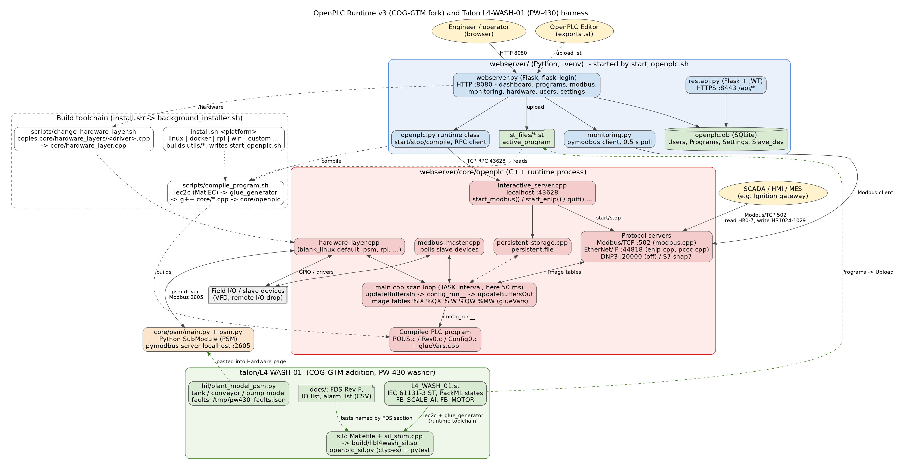

# Architecture: OpenPLC Runtime v3 and the Talon L4-WASH-01 harness

This page describes how the code on `master` fits together: the upstream OpenPLC Runtime v3
(web UI, compiler pipeline, C++ scan engine, protocol servers, hardware layers) and the Talon
`talon/L4-WASH-01` assets that run on it (PW-430 washer ST program, FDS, SIL harness, HIL plant
model). The runtime is unmodified upstream code; Talon adds files only under `talon/`.



Diagram sources: [`diagrams/architecture.dot`](diagrams/architecture.dot) (editable Graphviz) with
[PNG](diagrams/architecture.png) and [SVG](diagrams/architecture.svg) renders. After editing the
DOT file, run [`diagrams/render.sh`](diagrams/render.sh) (needs `graphviz`) to regenerate both.

## 1. Repository layout

| Path | What it is |
| --- | --- |
| `install.sh`, `background_installer.sh` | Installer. `./install.sh <platform>` (`linux`, `docker`, `rpi`, `win`, `custom`, ...) installs OS packages, creates `.venv`, builds the toolchain in `utils/`, writes `start_openplc.sh` and compiles the blank program. |
| `utils/` | Vendored sources built by the installer: MatIEC (`iec2c`), `st_optimizer`, `glue_generator`, OpenDNP3, libmodbus, snap7; `ethercat_src` is an optional git submodule. |
| `webserver/` | Python web tier (`webserver.py`, `restapi.py`, `openplc.py`, `monitoring.py`, `pages.py`), SQLite database `openplc.db`, uploaded programs in `st_files/`, and build scripts in `scripts/`. |
| `webserver/core/` | C++ runtime sources: `main.cpp` (scan loop), `interactive_server.cpp`, `modbus.cpp`, `modbus_master.cpp`, `enip.cpp`/`pccc.cpp`, `dnp3.cpp`, `persistent_storage.cpp`, `hardware_layers/`, `psm/`. |
| `documentation/` | Protocol notes (EtherNet/IP, S7) and this architecture page. |
| `talon/` | Talon Power Systems plant assets; see [section 5](#5-talon-l4-wash-01-pw-430-washer). |
| `Dockerfile` | Debian image that runs `./install.sh docker` and starts `start_openplc.sh`. |

## 2. Runtime processes

When the runtime is installed, `start_openplc.sh` activates `.venv` and starts
`webserver/webserver.py`. That one Python process serves two Flask apps:

- **Web UI** (`webserver.py`, `flask_login`): HTTP on `0.0.0.0:8080`. Pages: dashboard,
  programs (upload/compile), slave devices (`/modbus`), monitoring, hardware, users, settings,
  start/stop PLC and runtime logs. Users, programs, settings and slave devices live in
  `openplc.db`.
- **REST API** (`restapi.py`, `flask_jwt_extended`): HTTPS on `0.0.0.0:8443` under `/api`,
  sharing the same database.

The web tier never runs PLC logic itself. `openplc.py` (`runtime` class) launches the compiled
binary `webserver/core/openplc` as a child process and then talks to it over a plain-text TCP
command socket on `localhost:43628` (served by `interactive_server.cpp`). Commands include
`start_modbus(port)`, `start_dnp3(port)`, `start_enip(port)`, `start_snap7()`,
`start_pstorage(rate)`, the matching `stop_*()` calls, `runtime_logs()` and `quit()`. On start,
`configure_runtime()` reads the `Settings` table and issues the matching commands. Defaults in
the shipped database: Modbus `502`, EtherNet/IP `44818`, S7 (snap7) enabled, DNP3 disabled
(UI default port `20000`), persistent storage disabled, start in run mode `false`.

The monitoring page (`monitoring.py`) does not use the command socket: it is a `pymodbus`
client that polls the runtime's own Modbus server every 0.5 s and shows the located variables (`AT %...`)
parsed from the active `.st` file in `st_files/`. `parse_st()` is a line scanner: it skips any
declaration line that contains an ST comment and splits on single spaces, so it expects the form
`NAME AT %QX0.0 : BOOL;`. With `L4_WASH_01.st` (column-aligned, mostly commented declarations)
only 4 of its 41 located variables (`STACK_RED`, `STACK_AMBER`, `STACK_GREEN`, `HORN`) appear,
with blank type and location; use the SIL harness or a Modbus client to observe the rest.

## 3. Program build pipeline

Uploading a `.st` file stores it in `webserver/st_files/` and records it in the `Programs`
table; the active program name is kept in `webserver/active_program`, which must name a file that
also has a `Programs` row (upload through the UI rather than compiling from the CLI alone). Compiling runs
`webserver/scripts/compile_program.sh <file>.st`:

1. `iec2c` (MatIEC) translates the ST file to C (`POUS.c`, `Res0.c`, `Config0.c`,
   `LOCATED_VARIABLES.h`, `VARIABLES.csv`, ...), which the script moves into `webserver/core/`.
2. `glue_generator` turns `LOCATED_VARIABLES.h` into `glueVars.cpp`, which binds every located
   variable (`%IX`, `%QX`, `%IW`, `%QW`, `%MW`, `%MD`, `%ML`) to the runtime's image tables.
3. `g++` links the generated C with `core/*.cpp`, the selected `hardware_layer.cpp` and the
   protocol libraries into `core/openplc`.

The hardware page runs `scripts/change_hardware_layer.sh <driver>`, which copies
`core/hardware_layers/<driver>.cpp` to `core/hardware_layer.cpp`, writes the driver name to
`scripts/openplc_driver`, and triggers a recompile.

## 4. Scan engine, I/O and protocols

`main.cpp` starts the interactive server thread, calls `initializeHardware()`, then loops:

1. `updateBuffersIn()` (hardware layer) and `updateBuffersIn_MB()` (Modbus master).
2. `config_run__(tick)`: one execution of the IEC program.
3. `updateBuffersOut_MB()` and `updateBuffersOut()`.
4. `updateTime()` and sleep until the next tick. The tick is the IEC `TASK` interval; for
   L4-WASH-01 that is `T#50ms`.

The image tables are shared with the protocol servers under a buffer lock:

- **Modbus/TCP slave** (`modbus.cpp`): coils = `%QX`, discrete inputs = `%IX`, input registers
  = `%IW`, holding registers `0..1023` = `%QW` and `1024+` = `%MW`, with `%MD`/`%ML` above
  that. Up to 8192 coils/registers.
- **EtherNet/IP** (`enip.cpp`, `pccc.cpp`), **DNP3** (`dnp3.cpp`, OpenDNP3) and **S7**
  (snap7) expose the same tables.
- **Modbus master** (`modbus_master.cpp`) polls the slave devices configured on the
  `/modbus` page and copies their data into the input/output tables.
- **Persistent storage** (`persistent_storage.cpp`) periodically saves `%MW`/`%MD`/`%ML` to
  `persistent.file` and restores them at start.
- **Hardware layers** (`hardware_layers/*.cpp`): `blank.cpp` (drivers `blank`/`blank_linux`,
  the default, no I/O), `raspberrypi`, `pixtend*`, `unipi`, `neuron`, `sequent`, `simulink`,
  `psm`, and others.

### Python SubModule (PSM)

With the `psm_linux`/`psm_win` driver, `hardware_layer.cpp` is `hardware_layers/psm.cpp`. It
starts `.venv/bin/python3 -u ./core/psm/main.py` and exchanges I/O with it over Modbus/TCP on
`localhost:2605`, where `core/psm/psm.py` runs a `pymodbus` server. The user's `main.py` (edited
in the hardware page's code box) implements `hardware_init()`, `update_inputs()` and
`update_outputs()` using `psm.get_var(...)` / `psm.set_var(...)`. This is how the Talon HIL plant
model attaches to the runtime.

## 5. Talon L4-WASH-01 (PW-430 washer)

`talon/L4-WASH-01/` holds one machine: the PW-430 parts washer on Kingsport Engine Plant Line 4.

| Path | Role |
| --- | --- |
| `L4_WASH_01.st` | IEC 61131-3 ST program `L4_WASH_01` (function blocks `FB_SCALE_AI`, `FB_MOTOR`) with a PackML/ISA-TR88 state model, wash sequence, tank level/temperature control and alarm handling. `CONFIGURATION Config0` runs it as `Inst0` in `TASK Main(INTERVAL := T#50ms)`. |
| `docs/FDS-L4-WASH-01.md` | Functional design spec: equipment, PackML states, safety/interlocks (E-stop abort, STOP controlled stop, door hold, latched tank-low and heater high-limit), sequence, tank control, HMI/MES interface. |
| `docs/IO-List-L4-WASH-01.csv` | Tag to IEC address, device, terminal and Modbus address. |
| `docs/Alarm-List-L4-WASH-01.csv` | Alarm bits, priority, trigger, latching, response and clear condition. |
| `sil/` | Software-in-the-loop harness (below). |
| `hil/plant_model_psm.py` | PSM plant model for running the real runtime against a simulated washer (below). |

HMI/MES integration is plain Modbus/TCP on the runtime's slave port: status and outputs in
holding registers `0..7` (`%QW`), setpoints written to holding registers `1024..1029`
(`%MW0..5`), per the FDS and IO list.

### SIL harness (`talon/L4-WASH-01/sil`)

Runs the ST program without the runtime process or any network:

1. `make` uses the runtime's own toolchain (`webserver/iec2c`, `webserver/core/glue_generator`,
   MatIEC `lib/` headers), so `install.sh` must have been run first. It compiles
   `L4_WASH_01.st` to C, generates glue variables, and links `Res0.c` + `Config0.c` + glue +
   `sil_shim.cpp` into `build/libl4wash_sil.so`.
2. `sil_shim.cpp` exports a small C ABI (`sil_init`, `sil_scan`, `sil_set_ix`/`sil_get_qx`,
   `sil_set_iw`/`sil_get_qw`, `sil_set_mw`/`sil_get_mw`, `sil_time_ms`, ...). Each `sil_scan`
   advances simulated time by one task tick and calls `config_run__`.
3. `openplc_sil.py` loads the library with `ctypes`, maps ST tag names to addresses from the
   located variables, and gives tests `set`/`get`/`run(ms)`/`pulse`/`state`/`alarm` helpers;
   time is simulated, so tests do not sleep.
4. `make test` runs `pytest`. `conftest.py` provides fixtures that drive the machine to
   healthy/idle/execute/washing states; `test_fds_4_safety.py`, `test_fds_5_sequence.py` and
   `test_fds_6_tank_heater.py` hold 20 tests named after FDS sections.

### HIL plant model (`talon/L4-WASH-01/hil/plant_model_psm.py`)

Pasted into the runtime's Hardware page with the PSM driver selected, it closes the loop with
the real `core/openplc` binary: `update_outputs()` reads coil/register outputs (pump, heaters,
conveyor, make-up valve, door lock) and `update_inputs()` writes simulated sensors (1,500 L
tank level and temperature with three 18 kW elements, spray pressure, conveyor photoeyes, pump
auxiliary contact, E-stop and door). Faults are injected by writing JSON to
`/tmp/pw430_faults.json` (E-stop, door open, tank leak, stuck contactor, heater trip,
transmitter open loop, jam, downstream full, STOP and reset/start pulses).

## 6. Build and run commands

```bash
./install.sh linux                 # or: docker build -t openplc:v3 .
./start_openplc.sh                 # web UI on http://localhost:8080 (HTTPS API on :8443)

cd talon/L4-WASH-01/sil
make && make test                  # SIL: build libl4wash_sil.so and run the FDS tests
```

## 7. Security notes

The runtime is upstream end-of-life code. [`talon/SECURITY-SWARM.md`](../talon/SECURITY-SWARM.md)
records the OT security review scope; architecturally relevant points are that Modbus,
EtherNet/IP, DNP3 and S7 have no authentication, the command socket on `43628` is
unauthenticated (loopback only), the web UI is plain HTTP on `8080`, and the PSM code box runs
arbitrary Python as the runtime user by design.
